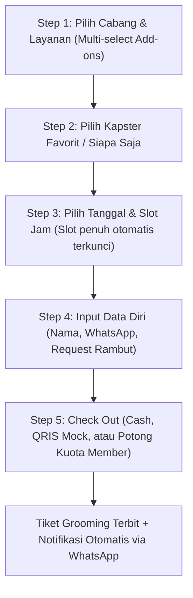

# Product Requirement Document (PRD)
## Platform: The Gentleman's Cut Barbershop SaaS & Online Booking

**Versi Dokumen:** 2.0  
**Tanggal:** 12 Oktober 2026  
**Status:** Implemented & Verified (Production Ready)  
**Target:** Solusi Manajemen Barbershop Modern (Pelanggan Online & Kasir POS)

---

### 1. Executive Summary & Visi Produk
**The Gentleman's Cut Barbershop** adalah aplikasi web SaaS modern all-in-one yang menghubungkan pengalaman reservasi online pelanggan (*Customer Portal*) dengan sistem operasional kasir (*Cashier & POS Backoffice*).
Sistem mengadopsi estetika *clean minimalist, modern startup* dengan dual-mode tema:
- **Mode Cerah Modern (Warm Neutral / Cream Amber)**: Bersih, terang, hangat, dan ramah pengguna.
- **Mode Dark Luxury (Matte Slate & Amber Gold)**: Elegan, maskulin, dan berkelas tinggi.

---

### 2. Arsitektur Dual-Role & Autentikasi Demo
1. **Customer View**:
   - Dapat diakses langsung oleh semua pengunjung tanpa login.
   - Fitur: Reservasi Online 5 Langkah, Eksplorasi Katalog Layanan & Add-on, Pembelian & Pengecekan Kuota Grooming Pass Membership, serta Pencarian Tiket Booking.
2. **Admin / Kasir (POS) View**:
   - Proteksi otorisasi berbasis kredensial demo.
   - Kredensial default: **Username: `admin`**, **Password: `admin`** (tersedia tombol *1-Click Demo Autofill*).
   - Jika belum login, rute kasir terkunci dan menampilkan modal autentikasi admin.

---

### 3. State Management & Database Mock Lokal
Sistem menggunakan sinkronisasi state React dengan persistensi otomatis ke `localStorage`:
- **Barber Specialists (5 Kapster)**:
  * Rama Pratama (Fade Master - Rating 4.9)
  * Dimas Anggara (Classic Scissor - Rating 4.8)
  * Bima Arya (Beard Sculpting - Rating 5.0)
  * Farhan Maulana (Colorist & Fringe - Rating 4.7)
  * Kevin Sanjaya (Executive Cut - Rating 4.9)
- **Katalog Layanan & Add-on (CRUD)**:
  * Classic Gentleman Cut (Rp 60.000 / 30 m)
  * Beard Trim & Royal Shave (Rp 35.000 / 20 m)
  * Hair Treatment & Wash (Rp 50.000 / 30 m)
  * Full Grooming Package (Rp 120.000 / 60 m)
  * Add-on: Pomade Styling (Rp 25.000), Hair Tattoo (Rp 40.000), Coloring (Rp 50.000)
- **Langganan Membership (Grooming Pass)**:
  * *Gentleman Essential* (Rp 120.000/bln - Kuota 2x potong/bulan)
  * *Royal VIP Club* (Rp 250.000/bln - Unlimited haircut & priority booking)
- **Manajemen Reservasi & Antrean**:
  * 5 status: `Menunggu / Scheduled`, `Sedang Dikerjakan / In-Chair`, `Selesai / Completed`, `Dibatalkan / Cancelled`, `No-Show`.

---

### 4. Alur Kerja Reservasi (5-Step Customer Booking Flow)

---

### 5. Fitur Kasir & Admin Dashboard (POS)
1. **4 Kartu Metrik Interaktif**:
   - Total Booking Hari Ini (+ persentase kenaikan)
   - Total Pendapatan / Revenue Kotor (IDR)
   - Antrean Kursi Sedang Berjalan (*In-Chair Active*)
   - Jumlah Anggota Membership Aktif (*Recurring Subscribers*)
2. **Timeline Visualisasi Antrean Kapster**:
   - Grid per jam untuk masing-masing dari 5 kapster.
3. **Tabel Antrean & Filter Cepat**:
   - Live search (Nama / WhatsApp / Kode Booking).
   - Filter kapster & filter status.
   - Dropdown instan untuk mengubah status (misal: Menunggu → In-Chair → Selesai).
4. **Input Cepat Walk-In**:
   - Form kasir untuk mencatat pelanggan yang langsung datang ke tempat.
5. **Toast Notifications**:
   - Umpan balik langsung untuk setiap aksi penambahan data, update status, dan penghapusan.
