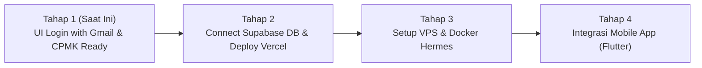

# Product Requirement Document (PRD)
## Proyek: Portal Autentikasi Aslab SIBER (Web Login with Gmail)

**Dokumen Versi:** 1.0  
**Tanggal:** 12 Oktober 2026  
**Penulis:** Tim Asisten Laboratorium Keamanan Siber & Jaringan  
**Target:** Persiapan Ujian CPMK & Standardisasi Ekosistem Lab  

---

### 1. Latar Belakang & Ringkasan Eksekutif
Berdasarkan arahan rapat asisten laboratorium dan kebutuhan evaluasi Capaian Pembelajaran Mata Kuliah (CPMK), dibutuhkan sebuah sistem portal terintegrasi untuk Asisten Lab SIBER. 
Tahap awal yang paling mendesak adalah **implementasi antarmuka login (UI Login)** yang mendukung autentikasi Single Sign-On (SSO) menggunakan **Google OAuth (Gmail)**.

Halaman dashboard pasca-login di tahap ini difungsikan sebagai bukti keberhasilan autentikasi (Proof of Concept) sekaligus wadah penempatan modul-modul sistem yang akan dibangun berikutnya (VPS Management, Sync Flutter Mobile, dsb).

---

### 2. Tujuan Produk (Product Goals)
1. **Memenuhi Kriteria CPMK**: Menyediakan flow autentikasi modern menggunakan akun Google (Gmail) yang valid dan dapat diuji saat penilaian.
2. **Standardisasi Stack**: Menggunakan ekosistem Node.js (Next.js) yang siap dideploy secara instan ke Vercel (CI/CD via GitHub).
3. **Dual-Mode Authentication**:
   - *Demo / Mock Mode*: Memungkinkan pengujian antarmuka dan navigasi secara langsung tanpa terhambat setup kredensial cloud.
   - *Production Supabase OAuth*: Terhubung ke Supabase Auth dengan Google Cloud Console OAuth 2.0.
4. **Desain Bertema Keamanan Siber**: Tampilan antarmuka profesional dengan sentuhan cyber security, dark mode, dan palet warna laboratorium.

---

### 3. Persona Pengguna (User Personas)
* **Dosen / Penguji CPMK**: Memeriksa kelayakan antarmuka, responsivitas tombol Google Login, dan transisi ke halaman terautentikasi.
* **Asisten Laboratorium**: Pengguna utama yang login menggunakan akun email kampus / Gmail untuk mengelola modul praktikum.
* **Praktikan**: Pengguna masa depan yang akan mengakses materi dan lab virtual.

---

### 4. Kebutuhan Fungsional (Functional Requirements)

| ID | Fitur | Deskripsi | Prioritas |
|---|---|---|---|
| **FR-01** | **Google SSO Button** | Tombol "Lanjutkan dengan Google" dengan logo resmi, spinner saat proses autentikasi | P0 (Must Have) |
| **FR-02** | **Transisi Login ke Dashboard** | Setelah login berhasil, halaman berpindah ke state dashboard terautentikasi | P0 (Must Have) |
| **FR-03** | **Tampilan Profil Pengguna** | Menampilkan avatar Google, nama lengkap, email Gmail, role Aslab, dan status CPMK | P0 (Must Have) |
| **FR-04** | **Fitur Logout** | Tombol keluar untuk membersihkan session dan mengembalikan pengguna ke halaman login | P0 (Must Have) |
| **FR-05** | **Form Login Manual (Fallback)** | Input alternatif Email & Password untuk akses khusus laboratorium | P1 (Should Have) |
| **FR-06** | **Integrasi Supabase Auth** | Client library Supabase (`@supabase/supabase-js`) siap pakai dengan OAuth callback | P1 (Should Have) |
| **FR-07** | **Dummy Roadmap Modul** | Kartu placeholder: Server VPS Docker, Flutter Mobile, dan Vercel Pipeline | P2 (Nice to Have) |

---

### 5. Kebutuhan Non-Fungsional (Non-Functional Requirements)
1. **Performa**: Waktu muat awal di bawah 1.5 detik (dukungan Next.js SSR / Turbopack).
2. **Responsivitas**: Tampilan adaptif untuk smartphone, tablet, dan desktop (Tailwind CSS v4).
3. **Keamanan (Security)**: Penggunaan protokol OAuth 2.0, variabel lingkungan terisolasi di `.env.local` (tidak boleh bocor ke git repo).
4. **Deployment Compatibility**: 100% kompatibel dengan infrastruktur Vercel.

---

### 6. Arsitektur Teknologi (Tech Stack)
* **Framework Web**: Next.js 16 (App Router, Node.js v24)
* **Styling**: Tailwind CSS v4 + Lucide Icons
* **Authentication**: Supabase Auth (Google OAuth Provider) + Mock Simulation
* **Version Control**: Git & GitHub
* **Deployment**: Vercel (Frontend & Serverless Edge)
* **Mobile (Rencana Tahap 2)**: Flutter

---

### 7. Roadmap Pengembangan

